# ZeroCam `v1.3.3`

Cámara virtual de ultra baja latencia y código limpio para **Windows 10 / Windows 11 x64** y **Android 8.0+**, con pipeline de video H.264 acelerado por hardware **Zero-Copy** de extremo a extremo y transporte autenticado/cifrado **`ZeroCam Wire v2`**.

---

## Arquitectura General

```mermaid
flowchart LR
    subgraph Android["ZeroCam Mobile (Kotlin / API 26+)"]
        CAM["Camera2 Sensor"] -->|Surface Zero-Copy| ENC["MediaCodec H.264 HW"]
        ENC -->|ZeroCam Wire v2| NET["TcpStreamClient\n(USB 127.0.0.1 / Wi-Fi)"]
    end

    subgraph Host["ZeroCam Host (Windows 11 C++20 / Win32)"]
        ING["StreamIngest + AdbBridge\n(ECDH/ECDSA P-256 + AES-256-GCM)"] --> DEC["MF H.264 MFT (D3D11VA NV12)"]
        DEC --> GPU["D3D11Context + RVM DirectML + Bokeh GPU"]
        GPU --> PREV["PreviewRenderer\n(0.0% GPU oculta / tray)"]
        GPU --> IPC["Ring Compartido NV12\n(ipc_ring.bin ACL protegida)"]
    end

    subgraph VCam["Windows FrameServer / DirectShow"]
        IPC -->|OpenSharedResource Zero-Copy Win11| DLL["ZeroCamSource.dll\n(IMFDXGIBuffer)"]
        IPC -->|I420 / NV12 / YUY2 Bilineal Win10 y Win11 Discord/OBS/Zoom| DS["ZeroCamDShow64/32.dll\n(DirectShow Filter)"]
        DLL --> APPS["OBS / Zoom / Discord / Meet / Cámara Windows"]
        DS --> APPS
    end

    NET <-->|TCP 5000..5010 cifrado + UDP Discovery v2 :5001| ING
```



---

## Características Principales

- **Pipeline Hardware Zero-Copy:** en Android conecta `Camera2` → `MediaCodec` vía `Surface`; en Windows decodifica vía `CLSID_MSH264DecoderMFT` (`D3D11VA NV12`), rota por hardware con `ID3D11VideoProcessor` y entrega texturas DXGI compartidas mediante `ZeroCamSource.dll` hacia `FrameServer.exe`.
- **Experiencia 1-Clic desde PC y Prioridad Cable USB ↔ Wi-Fi:**
  - Al pulsar **Iniciar Cámara**, monta automáticamente el túnel `adb reverse`, despierta la app móvil y prioriza **Cable USB** (`127.0.0.1`).
  - Si desconectas el cable USB en medio de una llamada, salta automáticamente a **Wi-Fi cifrado** (si el PC tiene huella `FP` confiable y PIN configurado) y vuelve solo a **Cable USB** (`prefer_usb`) al reconectar.
- **UI Fluida y Vista Previa Bajo Demanda:** arranque/parada de cámara virtual en hilo trabajador MTA dedicado sin bloquear la ventana Win32; al minimizar a bandeja o activar modo eco (`0.0% GPU 3D`), el renderizador de vista previa se detiene sin cortar OBS/Zoom/Discord.
- **Retrato IA + Bokeh Óptico GPU y Control Remoto de Cámara:** segmentación RVM MobileNetV3 FP16 vía WinML DirectML (cargada directo desde recurso en memoria RAM) combinada con bokeh de disco óptico Vogel, ajustes de brillo/contraste/saturación/calidez, prioridad de rostro, clic/tap-to-focus, zoom por rueda, exposición (EV) y linterna.
- **Cierre Limpio de Recursos:** al cerrar `ZeroCam.exe` se detiene únicamente el daemon `adb.exe` embebido mediante `Job Object` (`JOB_OBJECT_LIMIT_KILL_ON_JOB_CLOSE`) y limpieza por ruta exacta, sin tocar otros ADB instalados en el sistema.

---

## Arquitectura de Seguridad (`ZeroCam Wire v2`)

- **Transporte Cifrado Extremo a Extremo:** handshake autenticado de 4 mensajes (**ECDH + ECDSA P-256**), autenticación Wi-Fi basada en PIN de 6 dígitos con **PBKDF2-HMAC-SHA256 (`100,000` iteraciones)** + **RFC 5869 HKDF-SHA256**, y sesión **AES-256-GCM** usando la cabecera Wire v2 de 20 bytes como AAD.
- **Discovery UDP v2 Anti-Spoofing (`:5001`):** datagramas `ZCAM_DISCOVER_V2` / `ZCAM_HOST_V2` firmados con la clave ECDSA P-256 persistente del PC + nonce anti-replay y fijado automático de huella (`FP`) por USB.
- **Protección en Reposo e IPC:**
  - PIN enmascarado cifrado en reposo con **Windows DPAPI** (`ZeroCam.exe`) y **AndroidKeyStore AES-256-GCM** (`ZeroCam Mobile`).
  - Límite de intentos Wi-Fi por IP (bloqueo temporal tras 5 fallos de PIN) y Firewall restringido a perfiles `Private | Domain` dentro de `LocalSubnet`.
  - `ipc_ring.bin` protegido por handle con DACL explícita (`SYSTEM`, `Administradores`, `LOCAL SERVICE`, `INTERACTIVE`), Mandatory Label `Medium`, validación anti-hardlink/reparse point y metadatos atómicos.
- **Endurecimiento de Binarios:** compilación Windows MSVC `/MT` con `/guard:cf`, `/GS`, `/sdl`, `/GR-`, `/GUARD:CF`, `/CETCOMPAT`, `/DYNAMICBASE`, `/HIGHENTROPYVA`, `/NXCOMPAT` y `/DEPENDENTLOADFLAG:0x800`; APK Release R8 firmado únicamente con **ECDSA P-256** (esquemas `v2 + v3`, `v1 = false`).

---

## Estructura del Repositorio

```text
.
├── CMakeLists.txt                  # Build CMake C++20 (ZeroCam, ZeroCamSource, ZeroCamSourceTest, zerocam_selftest)
├── README.md / CHANGELOG.md / LICENSE
├── windows/
│   ├── shared/                     # Protocolo Wire v2, criptografía CNG/DPAPI, IPC compartido NV12 y GUIDs COM
│   ├── app/                        # Aplicación Win32 Dark Mode, D3D11VA/DirectML, StreamIngest, AdbBridge y VirtualCameraHost
│   │   └── res/                    # Icono zerocam.ico y modelo RVM ONNX embebido (sin fallback externo)
│   ├── vcam_source/                # Servidor COM In-Proc ZeroCamSource.dll (Windows 11 FrameServer)
│   ├── dshow_source/               # Filtro DirectShow clean-room 64/32-bit (Windows 10 y Windows 11 Discord/OBS/Zoom)
│   └── tests/                      # Suite end-to-end zerocam_selftest.cpp
├── android/
│   ├── app/src/main/               # App Android Kotlin (Camera2, MediaCodec HW, TcpStreamClient, WireCrypto, UI)
│   ├── app/src/test/               # Pruebas unitarias JUnit (WireProtocolTest.kt — vectores cruzados CNG <-> JCA)
│   └── keystore.properties.example # Plantilla de firma Release ECDSA P-256 (sin credenciales)
├── installer/
│   └── ZeroCam.iss                 # Script de instalador Inno Setup 6 (x64)
└── scripts/
    ├── build_windows.ps1           # Compilación CMake + Ninja Release/Debug
    ├── package_release.ps1         # Empaquetado completo Windows + APK + firma Authenticode + Inno Setup
    ├── register_vcam.ps1           # Utilidad de registro/diagnóstico COM
    └── generate_brand_icons.py     # Generador de activos vectoriales e iconos de marca
```

---

## Requisitos de Compilación

- **Windows:** Windows 11 SDK (`10.0.26100.0` o compatible), Visual Studio 2022 Build Tools (MSVC C++20 + CMake + Ninja), Inno Setup 6 (opcional para instalador) y Android Platform Tools (`adb.exe`) para el paquete portable.
- **Android:** JDK 21, Gradle `8.11.1+` y Android SDK (API 36 `compileSdk`, build-tools con `apksigner`).

---

## Compilación y Pruebas

### 1. Compilar binarios Windows + suite de pruebas
```powershell
.\scripts\build_windows.ps1 -Config Release
```

Ejecutar la verificación integral end-to-end (requiere dos bitstreams H.264 Annex-B de prueba, por ejemplo 720p y 1080p):
```powershell
.\build\windows-x64-release\zerocam_selftest.exe ruta\720p.h264 ruta\1080p.h264
```
Incluye validación de D3D11VA Zero-Copy, rotación `ID3D11VideoProcessor`, `ZeroCamSource.dll` (`IMFDXGIBuffer` + reescalado CPU/GPU), RVM ONNX desde RAM, vectores cruzados HKDF/ECDH/AES-GCM/ECDSA/DPAPI, handshake Wire v2, rate-limit y cierre limpio de `AdbBridge`.

### 2. Pruebas unitarias y APK Android
1. Copia `android/keystore.properties.example` a `android/keystore.properties` y configura tu keystore ECDSA P-256 (o genera uno de pruebas con `keytool`).
2. Ejecuta pruebas unitarias y compilación desde `android/`:
```powershell
gradle testDebugUnitTest assembleRelease --no-daemon
```

### 3. Empaquetado completo (Windows + Android + Instalador)
```powershell
.\scripts\package_release.ps1 -Version "1.3.3"
```
Genera los artefactos finales dentro de `dist/` (excluidos del control de versiones).

---

## Licencia

Distribuido bajo licencia **MIT**. Consulta [LICENSE](LICENSE) para más detalles.
